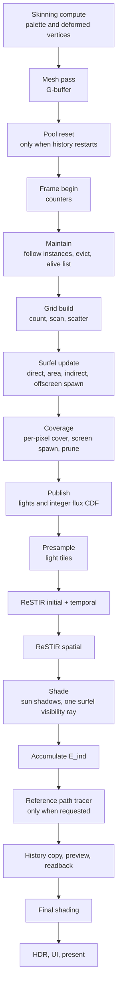

# 1. The frame

One command buffer per frame skins meshes, draws the G-buffer, runs the GI section, and composites the image. The GI section is recorded by `GILighting::record_rendering_commands` in `global_illumination.rs`. Each of its passes is separated from the next by a full compute and ray-tracing memory barrier, so every pass sees everything the previous one wrote.

## Order

| Pass | Shader | What it answers |
|---|---|---|
| Mesh | `mesh_rendering.frag` | Which position, normal, albedo, and instance are at this pixel? |
| Pool reset | `gi/pool_reset.comp` | Empty the pool (history restart only). |
| Frame begin | `gi/frame_begin.comp` | Last frame's output list becomes this frame's input; counters return to zero. |
| Maintain | `gi/maintain.comp` | Where is each surfel now, and does it survive? |
| Grid | `gi/grid_build.comp`, `gi/grid_scan.comp` | Which surfels can contain a given point? |
| Surfel update | `gi/surfel_update.rgen` | How much light reaches each surfel, how much surface does it own, and which offscreen surfaces need surfels? |
| Coverage | `gi/surfel_coverage.comp` | How well is each pixel covered, which surfel dominates it, and where should surfels be added or removed? |
| Publish | `gi/publish.comp` | How much power does each surfel emit, and what is the CDF over that power? |
| Presample | `gi/presample.comp` | 32768 surfels drawn in proportion to power, for the ReSTIR candidates. |
| Temporal | `gi/restir_temporal.comp` | Initial RIS over 8 candidates, merged with the reprojected reservoir. |
| Spatial | `gi/restir_spatial.comp` | Merge with 4 neighbouring reservoirs. |
| Shade | `gi/restir_shade.rgen` | Direct sun light, and the selected surfel's light if it is visible. |
| Accumulate | `gi/accumulate.comp` | Running mean of the indirect light over up to 32 reprojected frames. |
| Reference | `gi/reference.rgen` | Ground-truth indirect light, accumulated while the view is still. |
| Final | `final_rendering.frag` | `albedo * (E_dir + E_ind)`, or a debug view. |

Hardware ray tracing happens only in the three ray generation passes: surfel update, shade, and reference. All of them use the closest-hit shader `gi/hit.rchit`. It returns the interpolated shading normal facing the ray, the albedo sampled with `textureLod`, the instance id, and the hit distance.

## Counters that control history

Three numbers in the status block (`gi_data`, chapter 2) decide what may be reused.

- **`gi_reuse_frames`** is `prev_frame_gi_reuse` in `system.rs`. It is 0 on the first frame and after `reset_gi_accumulation()`, a scene change, or a TLAS rebuild. Otherwise it counts frames. When it is 0, the GI images are cleared, the pool is reset, and temporal reuse and accumulation are skipped for that frame. Moving the camera does **not** reset it: surfels live in world space and every per-pixel history is reprojected.
- **`frame_index`** increases by one every recorded frame. Its parity selects which alive list and which reservoir buffer are this frame's output. It also seeds every random number generator.
- **`still_frames`** counts frames with an unchanged view and projection. 0 restarts the reference accumulation.

The UI toggles (chapter 10) call `reset_gi_accumulation()` when they change what the history means. Turning the reference on or off does not, because the reference only adds a pass.

## Images that survive the frame

| Image | Writer | Reader |
|---|---|---|
| `IMG_EDIR` | shade | final |
| `IMG_EIND_RAW` | shade | accumulate |
| `IMG_EIND` | accumulate | final; copied to `IMG_EIND_HISTORY` at the end of the frame |
| `IMG_EIND_HISTORY` | copy | accumulate (next frame, reprojected) |
| `IMG_EREF` | reference | final, capture |
| `IMG_COVERAGE` | coverage | final (coverage view) |
| `IMG_ALBEDO` | shade, only on capture frames | capture |
| `surfel_overlay` | coverage: dominant surfel id per pixel | final (surfel-id view), self-test |

## Bisecting

`ART_RTIC_STOP_AFTER=none|mesh|gi|final|hdr|ui|all` ends the command buffer after the named stage. Any value other than `all` also skips acquire and present, so the loop runs unthrottled. That is handy for GPU timing (chapter 11).
