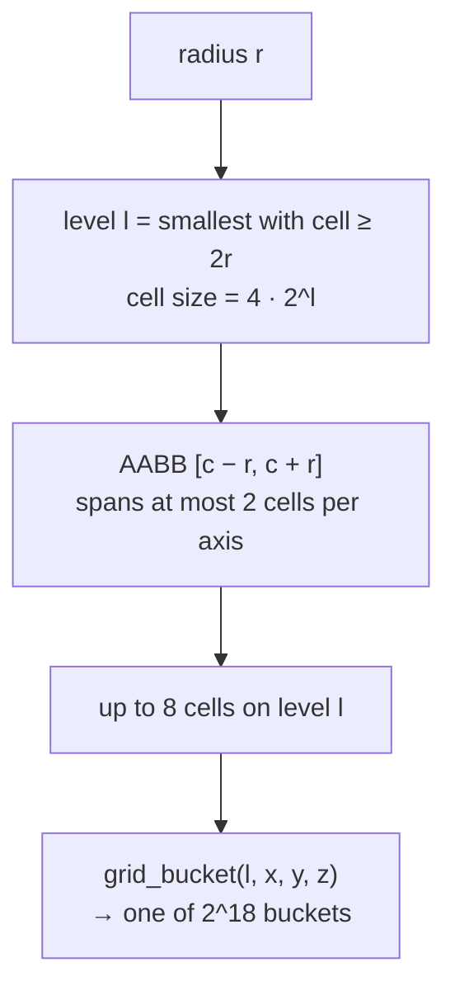
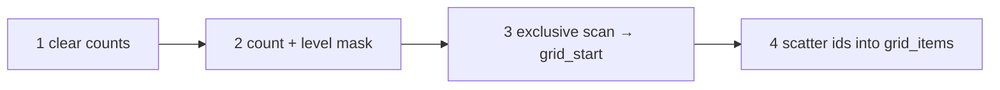
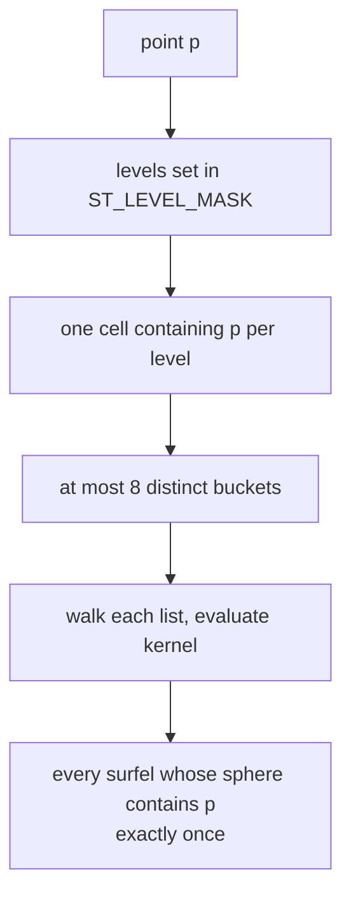

# 4. Spatial hash

Every query in the pipeline asks the same question: *which surfels' spheres contain this point?* The answer comes from a multi-level hashed grid in CSR form, rebuilt from scratch every frame over the survivors. It costs about 0.07 ms for 50 000 surfels on an RTX 4080 Laptop GPU, and nothing is ever sorted.

## Levels

There are `GRID_LEVELS` = 8 levels. Level `l` has cubic cells of size `GRID_BASE_CELL · 2^l`, from 4 to 512 world units.

A surfel of radius `r` lives on the smallest level whose cell is at least its diameter (`grid_level`). The surfel's bounding box `[c - r, c + r]` is then at most one cell wide on that level, so it overlaps at most 2 × 2 × 2 cells. The surfel is inserted into each of those cells' buckets. `surfel_buckets` removes duplicates when two cells hash to the same bucket.

That bound needs `SURFEL_MAX_RADIUS ≤ GRID_BASE_CELL · 2^(GRID_LEVELS-1) / 2` (256). `config.glsl` says so next to the constant, and the unit test `grid_level_cell_holds_diameter` checks it.

## Buckets

A cell `(x, y, z)` on level `l` maps to one of `GRID_BUCKETS` = 2^18 buckets through a chain of `hash_u32` (lowbias32) over the level and the three coordinates (`grid_bucket`). Different cells, including cells on different levels, can share a bucket. That is harmless: a bucket is only a candidate list, and every query evaluates the actual kernel of each candidate.

## Build

`grid_build.comp` and `grid_scan.comp` run as six dispatches separated by barriers:

1. **clear**: `grid_count[] = 0`; freeze `ST_SURVIVORS`; clear `ST_LEVEL_MASK`;
2. **count**: each survivor `atomicAdd`s the count of each of its buckets and `atomicOr`s its level into the mask;
3. **scan**, in three phases: per-block totals, a scan of the totals, then a per-block exclusive scan plus offset. This writes `grid_start[]` and `grid_cursor[]`; `grid_start[GRID_BUCKETS]` is the item total;
4. **scatter**: each survivor writes its id at `atomicAdd(grid_cursor[b], 1)` for each of its buckets.

Inside a bucket the order is whatever the atomics produced. Queries never depend on it.

## Query

`point_buckets(p)` returns the distinct buckets of the one cell containing `p` on every level whose bit is set in `ST_LEVEL_MASK`. If a surfel's sphere contains `p`, then `p` lies in its bounding box, and so in one of the cells the surfel was inserted into on its level. Every surfel whose sphere contains `p` is therefore found exactly once, at most 8 buckets are read, and empty levels are skipped.

So a lookup costs one hash per occupied level plus a walk over a few short lists. It does not depend on the number of surfels. Bucket lists stay short because coverage bounds the overlap (chapter 6): about 5 memberships per surfel, 270 000 items for 55 000 surfels.

## Checking it

The self-test (chapter 11) rebuilds the CSR on the CPU with `gi_math::surfel_buckets`. It checks that the GPU's table holds every surfel–bucket membership exactly once, that nothing else is in it, and that the level mask is correct.
