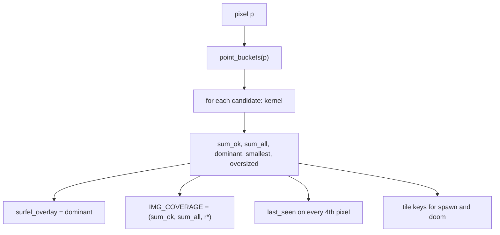
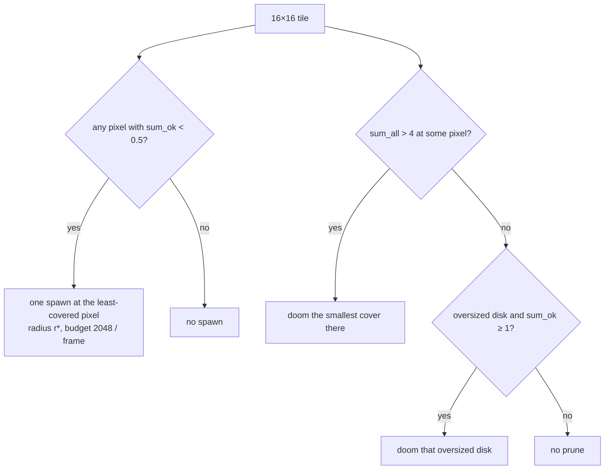

# 6. Coverage and spawn

`gi/surfel_coverage.comp` runs one 16 × 16 work group per screen tile after the surfel update. It makes sure every visible surface is covered, and keeps the overlap bounded.

## Per pixel

For the primary hit `p` at distance `d` from the eye:

- **Target radius**: \(r^\*(d) = \text{clamp}(d \cdot \text{pixel\_angle} \cdot 24,\ 2,\ 256)\), so a surfel spans about 24 pixels of radius when it is born. The radius is fixed for the surfel's life. Surfels that end up the wrong size because the camera moved are handled by pruning below and by eviction.
- **Cover**: the kernel sum over covering surfels (chapter 5), in two versions. `sum_all` counts every surfel. `sum_ok` leaves out *oversized* surfels, those larger than 2.5 × \(r^\*\).
- The dominant surfel goes into `surfel_overlay`. On every fourth pixel in x and y its `last_seen` is set to this frame. `IMG_COVERAGE` receives `(sum_ok, sum_all, r*, 0)`.

## Spawn

Each tile spawns at most one surfel per frame, at the pixel with the smallest `sum_ok`, provided that sum is below `SURFEL_SPAWN_COVERAGE` (0.5) and the pixel is within `SURFEL_MAX_DISTANCE`. The tile picks the pixel with an `atomicMin` on a shared key: the quantized cover in the high bits, the pixel index in the low 8 bits. Spawns are capped at `SURFEL_SCREEN_SPAWN_BUDGET` (2048) per frame, and need the `GI_FLAG_SPAWN` switch.

The new surfel takes the pixel's position, normal, albedo, and instance, with radius \(r^\*\).

There is no "too close to another surfel" rule. Disks are allowed to overlap, and they do: a typical on-screen point sits under several kernels at once. The partition of unity (chapter 5) turns that overlap into a share of the surface, so a point's area and cache radiance are never counted twice. Holes are what must not happen. Spawning keeps going until `sum_ok ≥ 0.5` everywhere on screen, which is why a warmed-up view is a continuous sheet of surfels rather than a sparse set of disks. With one spawn per tile per frame, a fresh view is covered within a few dozen frames: the self-test asks for 85% after 120 frames, and measured coverage is ≥ 99.9%.

How many that is follows from the target radius. A 24-pixel-radius disk covers about 1 800 pixels, so a 1920 × 1080 frame needs on the order of a few thousand on-screen surfels just to paint every pixel once. Overlap, plus the offscreen lights that bounce rays spawn (chapter 7), brings a still Sponza view to about 50 000–57 000 alive surfels out of the 65 536-slot pool. The overlay therefore looks dense: every surface pixel has a dominant surfel, and neighbouring disks share pixels.

## What the overlay shows

The surfel-id view (chapter 10) does not draw disks. Coverage writes the **dominant** id at each pixel — the covering surfel with the largest kernel — and final shading tints that pixel with a hash color of the id. A patch of one color is one surfel winning those pixels. The disks themselves are larger than those patches and cross the color boundaries; that is the overlap. The coverage view is the other half of the picture: green is a kernel sum near 1, blue is several kernels stacked (`sum_ok` well above 1), red is a hole.

## Prune

Each tile also marks at most one surfel `DOOMED` per frame. Maintain evicts it next frame. The candidate comes from the pixel with the largest `sum_all`:

- if `sum_all > SURFEL_OVER_COVERAGE` (4), the smallest surfel covering that pixel;
- otherwise, an oversized surfel once properly sized surfels around it already cover the pixel (`sum_ok ≥ 1`).

The first rule bounds the overlap, and with it the bucket lists and the cost of every query. The second rule replaces big surfels born far away with properly sized ones as the camera approaches. It only does so once the replacement cover exists, so pruning never opens a hole.

A settled cache (chapter 9) does not prune. Even with a still camera, pruning and spawning keep replacing a few dozen surfels per frame, and the image cannot converge while its lights keep changing.

## Offscreen surfaces

Coverage only sees the screen. The surfaces that light the screen from behind the camera, or around a corner, get surfels from the bounce rays of the surfel update (chapter 7).
