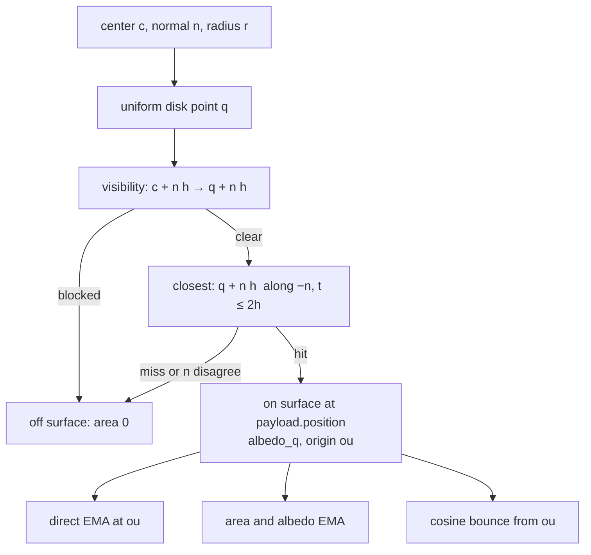
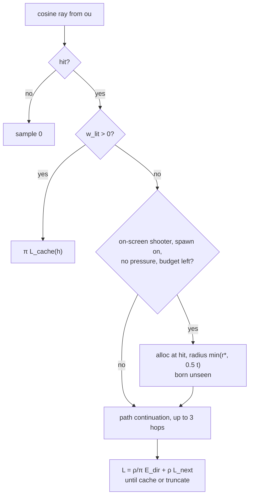

# 7. Surfel update

`gi/surfel_update.rgen` launches one invocation per survivor (`ST_SURVIVORS`). Every frame it refreshes four estimates per surfel, all of them exponential moving averages (EMA):

- direct irradiance \(\bar E_\text{dir}\), with floor \(\alpha = 0.05\);
- partition-of-unity area \(A\), with floor \(\alpha = 0.02\);
- albedo \(\rho\) of the surface under the disk, with the area's count;
- indirect irradiance \(\bar E_\text{ind}\), with floor \(\alpha = 0.03\).

The EMA uses \(\alpha = \max(1/(n+1), \alpha_\text{min})\). It is the exact running mean for the first \(1/\alpha_\text{min}\) samples and forgets old ones after that, which lets the cache follow moving lights and geometry. Once a still view's cache is stable (chapter 9), the floor is dropped and the count keeps growing, so the estimates become running means that converge.

## One disk sample, on the surface

A uniform point `q` on the disk serves both the area and the direct estimate. A disk is flat, but the surface under it may not be: the disk can hang over a ledge or poke through a wall. So `q` counts only if two rays agree that it is on the surfel's surface. Both run at height \(h = 0.25r + 0.25\) above the tangent plane, so a concave surface within the kernel's plane tolerance stays below them.

1. A probe from `c + n·h` to `q + n·h` must be unblocked: no wall between the center and `q`.
2. A ray from `q + n·h` along `-n`, with `t_max = 2h`, must hit a surface whose normal agrees with `n` (cosine ≥ 0.5): no drop-off at `q`.

The hit point of the second ray is where the surface actually is under `q`. That point, raised by `RAY_NORMAL_OFFSET`, becomes the origin `ou` for the direct and indirect rays.

## Direct light

\(E_\text{dir}\) at `ou` is the sum over directional lights of `cos · intensity`, with one shadow ray each (`direct_irradiance` in `gi/rt.glsl`). It feeds the EMA only when `q` is on the surface. The exception is a surfel without any sample yet, which takes one from its center so that it can become a light. The result is the mean direct irradiance over the part of the disk that really is surface. Parts hanging in the air, which would see the sun unobstructed, are not counted.

## Area

\(a = \pi r^2 \cdot [q \text{ on surface}] \cdot k_\text{self}(q) / \sum_k k_k(q)\) (chapter 5). A surfel on a thin strip, such as the lit top of an arch, ends up with roughly the strip's area under its disk. Its emitted power is then right even though its disk is wider than the strip.

The albedo found by the `-n` ray at an on-surface `q` feeds the albedo EMA. A surfel's light is then \(\rho/\pi\) times its irradiance, with the mean albedo under its disk rather than the single texel it was born on. A born-on texel can be a dark seam or a bright fleck, and on a textured curtain that varies from surfel to surfel.

## Indirect light and discovery

Every surfel that is on screen (touched by coverage within 2 frames) traces one cosine-weighted ray from `ou`. With multibounce on, every other surfel traces one too. Where it lands:

- **The cache covers the hit** (`w_lit > 0`): the sample is \(\pi L_\text{cache}(h)\). The hit's dominant surfel gets its `last_seen` refreshed (chapter 3).
- **The cache does not cover the hit.**
  - If the shooting surfel is on screen, spawning is on, the pool is not under pressure, and fewer than `SURFEL_RAY_SPAWN_BUDGET` (256) ray spawns happened this frame, a surfel is spawned at the hit. A settled cache stops these spawns `SURFEL_SETTLE_SPAWN_FRAMES` (256) frames after it settled (chapter 9). Its radius is \(\min(r^\*(d), 0.5\,t)\), where `t` is the ray length. The cap keeps the light that a surfel sees from very close by from being smeared over a disk larger than the gap it crosses. The newborn is marked as not on screen, so its own rays do not spawn further surfels.
  - The radiance at the hit is computed directly: \(L(h_1) = \tfrac{\rho_1}{\pi} E_\text{dir}(h_1) + \rho_1 L(h_2)\), where \(h_2\) is found by a cosine ray from \(h_1\). The recursion continues until a hit is covered by the cache, which then supplies \(L\), or for at most `SURFEL_PATH_CONTINUATION` (3) bounces. Without that continuation, every uncovered hit would lose its own indirect light. In Sponza, adding it moved the multibounce bias from about -5% to -3%.

The indirect EMA is updated only when multibounce is on. Without multibounce, \(\bar E_\text{ind} = 0\) and surfels only carry direct light, which makes the image exactly one bounce. The discovery rays still run in that mode, because offscreen surfaces are lights for the first bounce too.

`payload` is shared by every `traceRayEXT` in the shader. Any field needed after a later trace (including the shadow rays inside `direct_irradiance`) must be copied to a local right after `trace_closest`.

## Cost

About 1.3 ms for 50 000 surfels. Per surfel that is 2 rays for the on-surface test, 2 shadow rays, a bounce ray, and occasionally continuation rays and their shadow rays.
