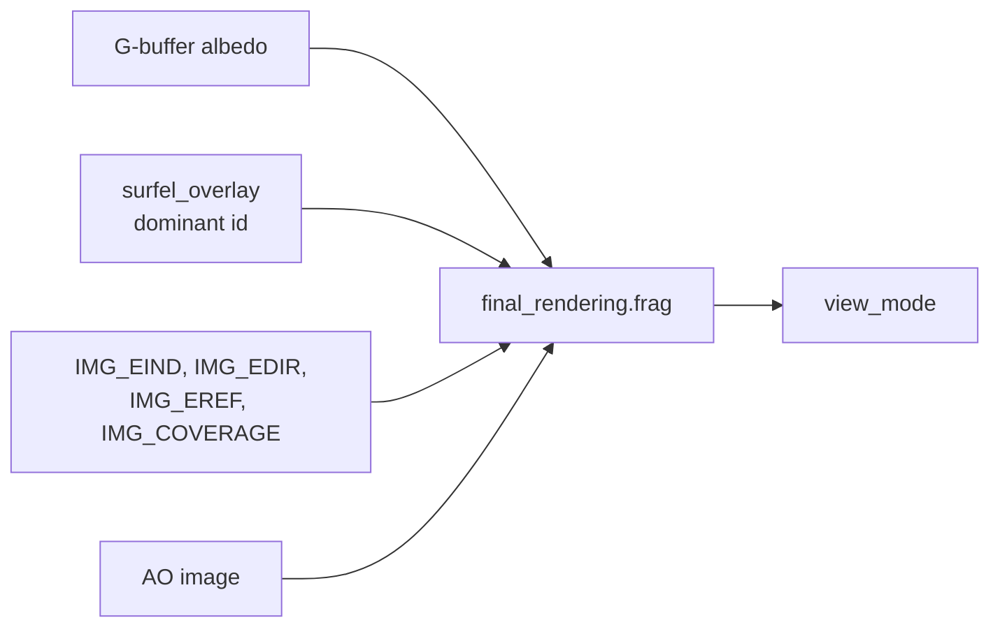
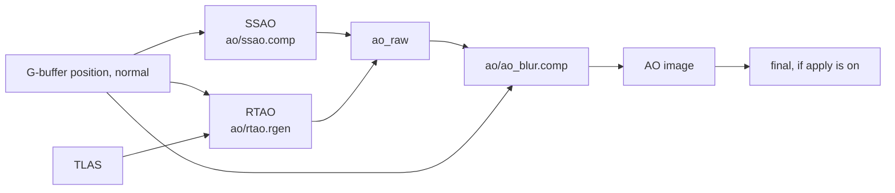

# 10. Composite

After the GI section, `system.rs` writes the ambient-occlusion image, then runs final shading, HDR, the optional UI composite, and the present quad.

## Final shading

`final_rendering.frag` reads the G-buffer albedo, the overlay (`surfels_buffer`), and four GI images (`gibuffer[4]` = `IMG_EIND`, `IMG_EDIR`, `IMG_EREF`, `IMG_COVERAGE`). What it writes depends on `debug_data.view_mode`:

| View | Index | Output |
|---|---|---|
| Final | 0 | \(\rho\,(E_\text{dir} + a\,E_\text{ind})\), with \(a = 1\) unless ambient occlusion is applied |
| Surfel ids | 1 | final, tinted by a hash color of the dominant surfel |
| Surfel coverage | 2 | cover `sum_ok`: red→yellow below 0.5, green near 1, green→blue above 1.5 |
| Indirect | 3 | \(\rho\,a\,E_\text{ind}\) |
| Indirect irradiance | 4 | \(a\,E_\text{ind}\) |
| Reference | 5 | \(\rho\,(E_\text{dir} + E_\text{ref})\) |
| Reference indirect | 6 | \(\rho\,E_\text{ref}\) |
| Difference | 7 | relative luminance error of \(E_\text{ind}\) against \(E_\text{ref}\): red = too bright, blue = too dark, grey = match |
| Ambient occlusion | 8 | the AO image: white is an open hemisphere, black is fully occluded |

Sky pixels are black in every view except coverage and ambient occlusion. The three reference views switch the path tracer on automatically (`DebugState::reference_active`). They are meaningful only once it has accumulated for a while: it restarts whenever the camera moves. The GI image does not converge to the reference. With the camera still it converges to the surfel cache's own answer, which differs from the reference by the error measured in chapter 11.

"Show surfels" with the Final view selects the surfel-id view.

That view is a map of **who wins at this pixel**, not a drawing of the disks. Coverage stores the dominant surfel id in `surfel_overlay`; the shader hashes the id into a color and mixes it over the shaded image. Adjacent pixels of the same color share the same winner. The disks are larger than those color patches and overlap (chapter 6): several kernels can be nonzero at one point, and the partition of unity splits the point among them. A surface that is a continuous quilt of colors is covered. Gaps in the tint are holes (`id == 0xFFFFFFFF`). The coverage view (index 2) shows the kernel sum itself, which is the quantity spawn and prune actually use.

## The debug panel

The ImGui panel has the view combo, the "Show surfels" checkbox, "Apply ambient occlusion", an "AO algorithm" combo (SSAO or RTAO), and one checkbox per GI switch: multi-bounce, ReSTIR temporal reuse, ReSTIR spatial reuse, accumulate indirect, spawn surfels, converge when still (chapter 9), and path traced reference. Changing any GI switch other than converge and the reference resets the GI history, because the old history no longer means the same thing. The AO controls do not: the occlusion image is rebuilt every frame and does not feed the surfel cache. "Reset GI" resets the GI history explicitly. The console command `resetsurfels` does the same.

The same settings can be given at startup:

- `ART_RTIC_VIEW=<index>` selects the view (index from the table);
- `ART_RTIC_GI_DISABLE=multibounce,temporal,spatial,accumulate,spawn,converge` turns switches off;
- `ART_RTIC_GI_REFERENCE=1` turns the reference on;
- `ART_RTIC_AO=ssao|rtao` selects the algorithm (default `ssao`);
- `ART_RTIC_AO_APPLY=1` multiplies indirect light by the AO image;
- `ART_RTIC_AO_DUMP=path.pfm` writes the AO image from frame 8 after the run's fences complete.

## Ambient occlusion

After the GI section, when ambient occlusion is applied or the AO view is selected, `AmbientOcclusion::record_rendering_commands` fills one `r16f` image at the render resolution. The selected algorithm writes a raw image, and a bilateral blur (normal and plane tests) writes the image the composite samples. 1 means the hemisphere is open. Sky pixels are 1. While the feature is off the image stays at 1, which is what the clear stored, and the passes are not recorded.

SSAO takes 16 samples of a hemisphere of radius `AO_RADIUS` (64 world units) around the G-buffer normal, projects each sample, and reads the surface stored at that pixel. A sample adds occlusion when that surface lies in front of the receiver, inside the radius, and beyond `AO_BIAS`. Occlusion below `AO_SSAO_FLOOR` is dropped, so depth noise on an open wall stays at 1, and what remains is scaled by `AO_SSAO_SCALE`. The per-pixel rotation of the kernel is fixed, so a still camera does not shimmer.

RTAO casts 16 cosine-weighted rays of the same length from the receiver. The closest opaque hit at distance \(t\) contributes \((1 - t/R)^2\). Its closest-hit shader stores only \(t\). Rays are hardware ray queries against the TLAS, so the cost follows the scene's BVH rather than a screen-space neighborhood. Far from the camera, SSAO's radius collapses to a fraction of a pixel and the result goes to 1; RTAO keeps the world-space radius.

Applying the image uses \(\rho\,(E_\text{dir} + a\,E_\text{ind})\) on the final, surfel-id, and indirect views. Direct light is left alone: the shade pass already traces a shadow ray. The reference and difference views ignore the toggle, so a comparison against the path tracer stays a comparison of \(E_\text{ind}\). The surfel shade already tested visibility for its chosen light, so turning AO on darkens crevices a second time. It is off unless asked for.

## HDR, UI, present

`hdr_transform` maps the shaded image to display range. With UI enabled (the default), Dear ImGui renders offscreen into an `R8G8B8A8` image, and `ui_composite` blends it over the HDR image. ImGui never targets the swapchain. `ART_RTIC_NO_UI=1` skips the UI, and `renderquad` reads the HDR image directly. `renderquad` draws to the swapchain, and `prev_frame_gi_reuse` increments after the present.
