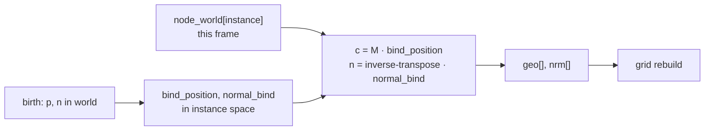

# 13. Moving surfels

A surfel is born on a surface that can move. The slot does not move; the world center does.

## What is stored

`surfel_init` writes the hit in the instance's space: `bind_position = inverse(node_world[instance]) * p`, and `normal_bind` is the normal transformed by the transpose of the model matrix. Every frame, maintain recomputes the world center and normal from the current node matrix (the normal through the inverse transpose) and refreshes `geo[]` and `nrm[]`. The grid is rebuilt from those afterwards. Moving instances therefore stay searchable without any special case, and their surfels keep their light estimates while they move. The EMAs follow the changed lighting.

`instance_generation` is copied from `instance_generation[instance]` at birth. When the scene replaces or removes an instance, its generation changes, and maintain evicts every surfel still pointing at the old one. No surfel ever follows an instance index that now means something else.

The node buffer has 4096 matrices, one per TLAS instance, in TLAS order. A scene node with many meshes writes the same world matrix into each of their slots. The raster shader builds the matrix with `row_major_3x4`, matching Vulkan's row-major 3×4 instance transform.

## Skinned meshes

`instance_model` can read a joint matrix from the bone palette when `bone` is not `BONE_RIGID`. Nothing sets `bone` yet: surfels on skinned meshes follow the instance's node matrix. On a deforming part, a surfel ends up off the surface. Its kernel stops covering those pixels (the plane test fails), coverage spawns surfels on the new surface, and the stale ones are evicted after `SURFEL_UNSEEN_FRAMES`. Attaching surfels to the dominant joint would fix that, but it needs the vertex weights at the hit.

## Scene file

`scene.json` next to the working directory replaces the hardcoded Sponza instance. After loading, the renderer binds the TLAS for ray tracing and adds the default directional lights. Each node has a name, an optional parent, a translation, and an optional tar path, and its world matrix is parent times local. `System::load_scene_file` loads each tar and adds one TLAS instance at that matrix. Later edits go through `replace_instance` and one TLAS rebuild. Any scene change resets the GI history, which also empties the surfel pool.

## Preview

`ART_RTIC_PREVIEW=1` listens on `ws://127.0.0.1:9761`. Each time frame slot 0 is reused, the previous slot's `IMG_EIND` (the accumulated indirect irradiance) has already been blitted to 640 × 360 and copied out. That JPEG is what the VS Code extension shows, one full frames-in-flight cycle late. The extension sends `look dx dy forward strafe`, and the spectator camera applies it.

Creating a tar still requires Compressonator and `toktx`. The engine never invokes them; `artrtic-cook` does, and only when asked to cook. Blender artists can run `tools/blender_artrtic/install.sh`, which builds `artrtic-cook` into `addon/bin/` and links Compressonator there, so no PATH setup is needed. See `tools/blender_artrtic/README.md`.
